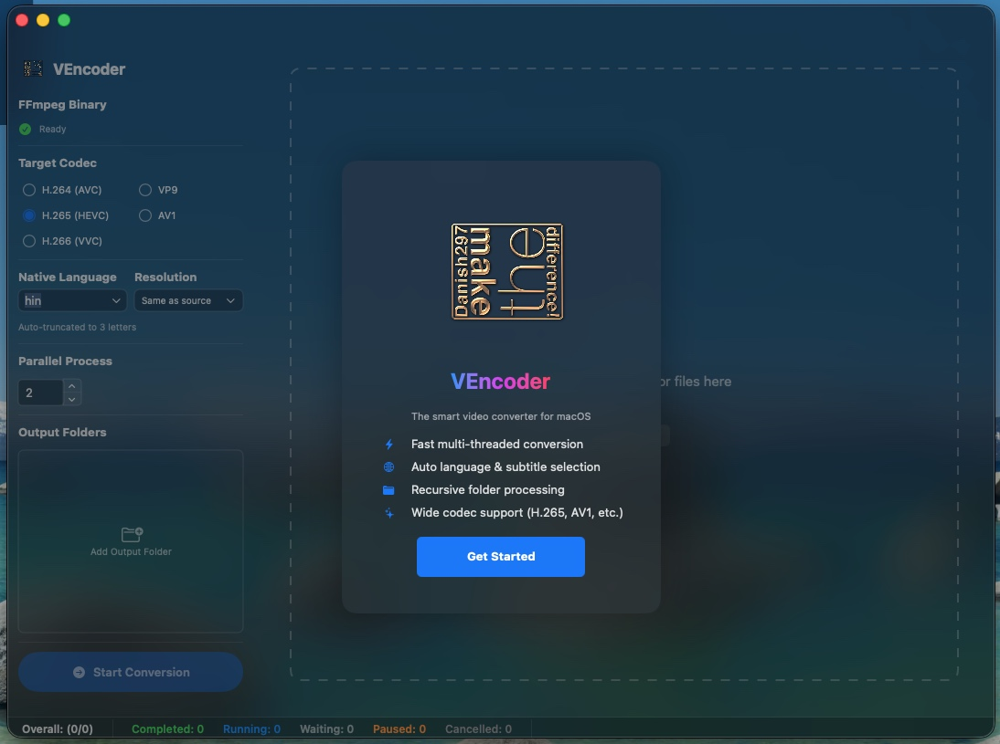
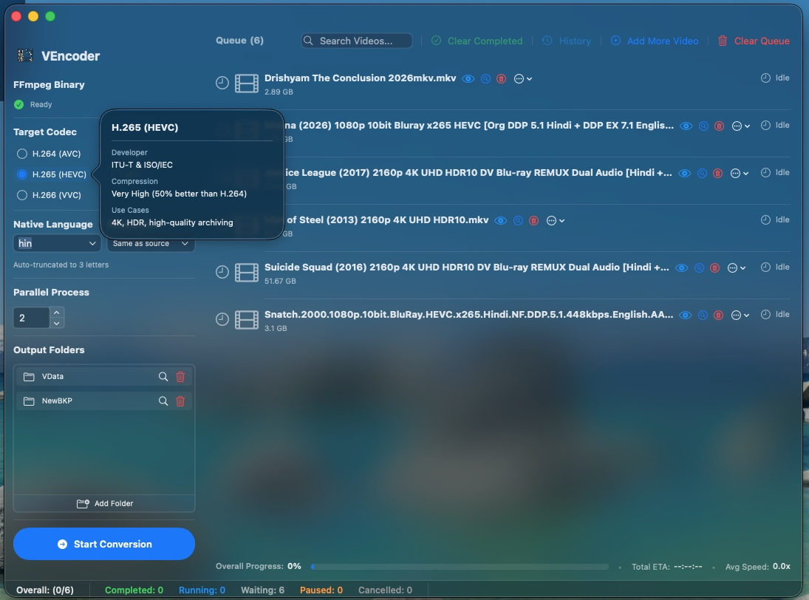
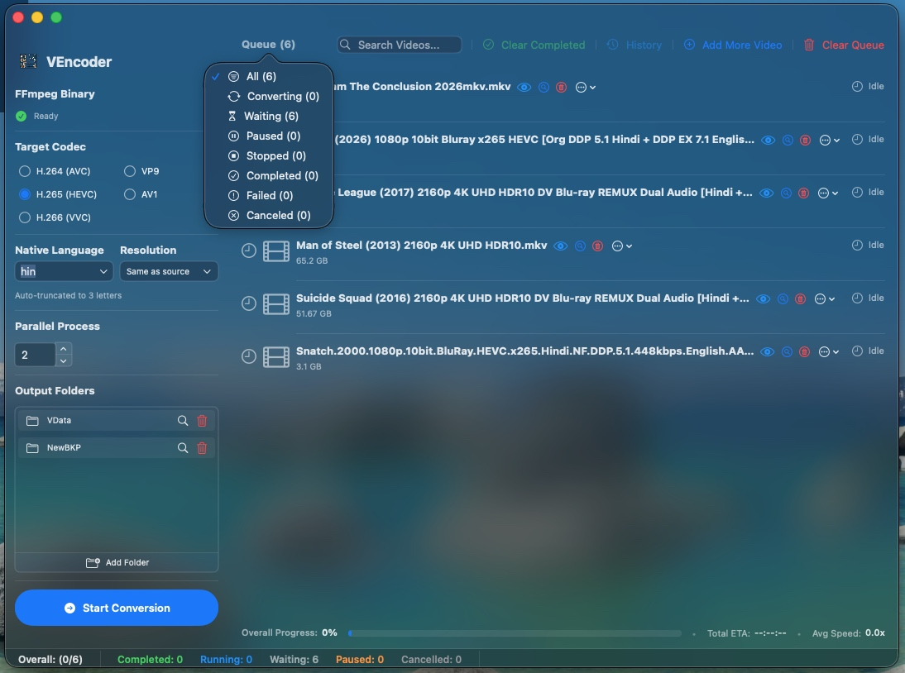
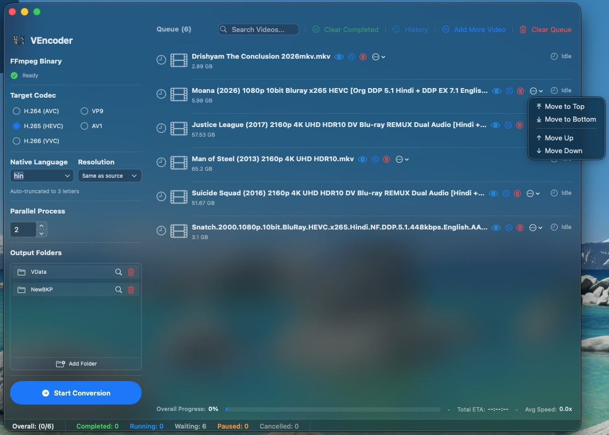

I developed VEncoder, a macOS application designed to make video
compression and batch conversion easier to manage.

The goal was to reduce video file sizes while retaining the original
resolution, bring common encoding settings into one interface, and
simplify the processing of multiple videos.

VEncoder combines an FFmpeg-based conversion workflow with codec
selection, configurable parallel processing, language preferences,
output-folder management, and a searchable conversion queue.

## The Challenge

Managing a growing video collection can involve more than choosing a
smaller output format. Different files may require different encoding
settings, contain multiple language tracks, or need to be processed in
a particular order.

Repeatedly configuring individual conversions also makes larger batches
time-consuming to organize.

I wanted to bring these tasks into a single macOS application that could:

- Reduce storage requirements without requiring a lower resolution.
- Provide a choice of target video codecs.
- Process multiple videos through a managed queue.
- Allow control over the number of simultaneous conversions.
- Simplify language selection and output-folder configuration.
- Make progress and processing status visible in one place.

## The Solution: A Centralized Video Conversion Workflow

VEncoder provides a graphical interface for configuring and managing
video conversions, rather than requiring users to prepare a separate
command for each file.

The interface brings together encoding settings, input videos, output
locations, and queue controls.

{fig-alt="VEncoder on macOS showing a welcome panel, codec selection, language and resolution settings, parallel-process control, and an area for adding videos or folders." width=100%}

The workflow is organized around five steps:

1. Add videos or folders.
2. Select a target codec.
3. Configure resolution, language preferences, and parallel processing.
4. Choose output folders.
5. Start conversion and monitor the queue.

## Encoding Controls

### Multiple Target Codecs

The interface provides the following target-codec options:

- H.264 / AVC.
- H.265 / HEVC.
- VP9.
- AV1.
- H.266 / VVC.

These options allow the encoding workflow to accommodate different
storage and playback requirements.

The interface also includes codec information popovers, giving users
additional context when choosing an encoding format.

{fig-alt="VEncoder showing target-codec options for H.264, H.265, VP9, AV1, and H.266, with an H.265 information popover open." width=100%}

The available encoder and hardware-acceleration path depend on the
installed FFmpeg build, selected codec, and capabilities of the Mac.
A codec appearing in the interface does not mean every Mac can encode
it using hardware acceleration.

### Retaining Source Resolution

VEncoder includes a “Same as source” resolution option, allowing users
to retain the input video's frame dimensions during conversion.

This supports the project's main objective: reducing file size without
requiring a reduction in resolution.

Preserving resolution does not mean the output is lossless. The final
file size and visual quality still depend on the source material and
encoding settings.

### Language and Subtitle Preferences

A native-language preference helps guide automatic language and
subtitle selection.

The interface accepts a short language code, bringing this preference
into the conversion setup rather than requiring users to configure it
separately for each video.

### Configurable Parallel Processing

The parallel-process control allows users to choose how many
conversions run simultaneously.

This provides a way to tune batch processing to the available system
resources. Hardware acceleration, where supported, can complement this
workflow, but parallel processing and hardware acceleration are separate
capabilities.

More simultaneous conversions do not automatically mean faster
completion. The most suitable setting depends on the encoding workload
and the machine's available resources.

## Queue Management

A batch conversion tool needs more than encoding controls. It also
needs to make a large collection of pending and completed work easy
to navigate.

VEncoder includes a queue with search, status filtering, and controls
for adding videos, clearing completed entries, and clearing the queue.

{fig-alt="VEncoder showing six queued videos and a status-filter menu with All, Converting, Waiting, Paused, Stopped, Completed, Failed, and Canceled categories." width=100%}

### Status-Based Filtering

The queue can be filtered by processing state:

- All.
- Converting.
- Waiting.
- Paused.
- Stopped.
- Completed.
- Failed.
- Canceled.

These categories help separate videos awaiting conversion from those
that have finished or require attention.

### Queue Reordering

Users can change the order of queued videos using:

- Move to Top.
- Move to Bottom.
- Move Up.
- Move Down.

This allows priorities to change without removing and re-adding files.

{fig-alt="VEncoder displaying a queue-entry menu with Move to Top, Move to Bottom, Move Up, and Move Down options." width=100%}

## Output Folders and Progress Visibility

### Output-Folder Management

The output-folder panel keeps destination locations visible alongside
the conversion settings.

Users can add folders and manage the listed destinations from the same
interface used to prepare the conversion queue.

### Progress Monitoring

The application includes both queue-level status counts and an overall
progress area.

The interface provides space for:

- Overall completion percentage.
- Estimated remaining time.
- Average processing speed.
- Counts of completed, running, waiting, paused, and canceled items.

This keeps the state of a batch visible without requiring users to
inspect individual conversion commands.

## Project Outcome

VEncoder brings video conversion setup and batch management into one
macOS interface.

The project combines:

| Capability | Purpose |
|:--|:--|
| Multiple target codecs | Provide flexibility when configuring conversions |
| Same-as-source resolution | Retain the input video's frame dimensions |
| Parallel processing | Configure the number of simultaneous conversions |
| Language preferences | Simplify language and subtitle selection |
| Queue search and filters | Find videos and review processing states |
| Queue reordering | Adjust conversion priorities |
| Output-folder management | Keep destination locations organized |
| Progress indicators | Track batch execution from one interface |

The screenshots demonstrate the application's interface and workflow.
They do not establish a measured compression ratio, encoding-speed
improvement, or visual-quality score.

Those results require before-and-after testing with documented source
files, encoding settings, and hardware.

## Key Takeaway

VEncoder turns a collection of video conversion tasks into a structured,
manageable workflow.

Its central design goal is to improve storage efficiency while retaining
source resolution, supported by flexible encoding options, configurable
parallel processing, and practical queue-management controls.

::: {.page-return-links}

[Home](../index.qmd) | [Achievements](../index.qmd#achievements) | [Featured Notes](../index.qmd#featured-notes) | [Projects](../index.qmd#projects) | [Notes](../notes/11g_Unknown_facts.qmd)

:::
