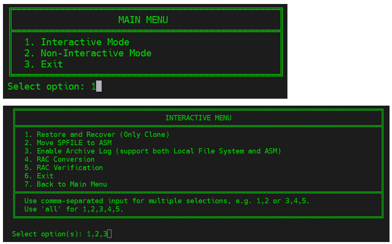
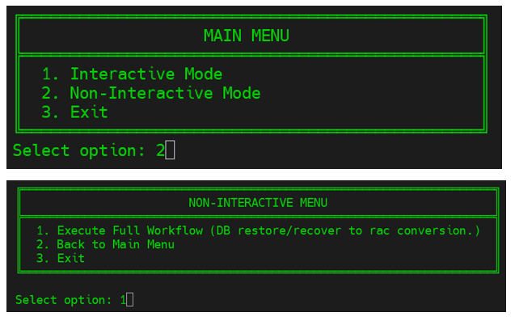
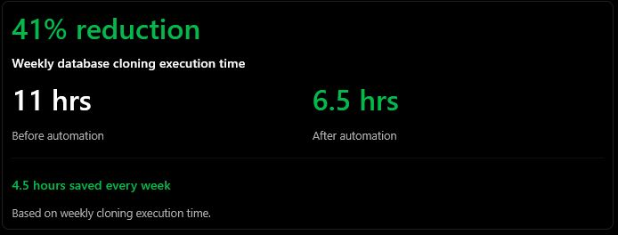

I designed and implemented a menu-driven Oracle Database recovery and
cloning framework to replace repetitive manual procedures with a
centralized, standardized workflow.

The result: **approximately 41% less execution time**, reducing weekly
database cloning from 11 hours to 6.5 hours and saving 4.5 hours each week.

## The Challenge

Database recovery and cloning involved multiple manual steps, operational
dependencies, and repeated intervention. Administrators had to manage
several related operations separately, increasing the effort required to
complete the overall workflow.

The main challenges were:

- Repeating the same recovery and cloning procedures each week.
- Coordinating individual operations and their dependencies.
- Maintaining consistent execution across multiple steps.
- Reducing opportunities for human error during repetitive tasks.

I wanted a single framework that could support both selective execution
and a complete cloning workflow without requiring administrators to
repeat the same manual sequence.

## The Solution: One Framework, Two Execution Modes

I developed a centralized menu-driven framework with interactive and
non-interactive execution modes.

Both modes use standardized execution flows, input handling, and reusable
automation logic. The distinction is how much control the administrator
needs over the individual steps.

### Interactive Mode: Select the Operations You Need

Interactive mode allows the administrator to choose individual operations
or select several operations together.

The available operations include:

1. Database restore and recovery for cloning.
2. SPFILE migration to ASM.
3. Archive log configuration for local file systems and ASM.
4. RAC conversion.
5. RAC verification.

Administrators can enter comma-separated selections, such as `1,2,3`,
or use `all` to select all five operations.

{fig-alt="Terminal screenshots showing the main menu and an interactive menu with restore and recovery, SPFILE migration, archive log configuration, RAC conversion, and RAC verification." width=100%}

This mode provides flexibility when only part of the workflow is required,
rather than requiring execution of the complete process.

### Non-Interactive Mode: Run the Complete Workflow

Non-interactive mode provides a single menu selection to initiate the
full workflow, from database restore and recovery through RAC conversion.

Instead of selecting operations individually, the administrator starts
the predefined sequence with one selection, reducing the need for repeated
manual intervention.

{fig-alt="Terminal screenshots showing selection of non-interactive mode and the option to execute the full workflow from database restore and recovery to RAC conversion." width=100%}

Here, “non-interactive” refers to the execution workflow after the initial
menu selection; the framework still presents a menu to start that workflow.

## Results: From 11 Hours to 6.5 Hours

The framework reduced weekly database cloning execution time by
4.5 hours—a reduction of approximately 41% compared with the previous
11-hour process.

| Measure | Result |
|:--|--:|
| Weekly execution time before automation | 11 hours |
| Weekly execution time after automation | 6.5 hours |
| Time saved each week | 4.5 hours |
| Execution-time reduction | Approximately 41% |

{fig-alt="Results summary showing weekly database cloning execution time reduced from 11 hours to 6.5 hours, saving 4.5 hours per week, approximately 41 percent." width=100%}

The percentage reduction is calculated against the original execution time:

\[
\text{Reduction} =
\frac{11 - 6.5}{11} \times 100
\approx 40.9\%
\]

These figures describe weekly cloning execution time, not a separately
measured reduction in hands-on administrator effort.

## Operational Impact

Beyond the measured time saving, the framework changed how the workflow
was organized:

- Centralized related database operations behind one menu.
- Reduced repetitive manual intervention during execution.
- Standardized the sequence and handling of common operations.
- Supported both selective execution and a complete workflow.
- Created reusable automation logic for future enhancements.

Reducing repeated manual steps also reduced opportunities for human error,
although error-rate improvements were not separately quantified.

## Key Takeaway

This project turned a multi-step manual Oracle Database recovery and
cloning process into a reusable, menu-driven workflow.

The most significant measured outcome was a reduction in weekly cloning
execution time from 11 hours to 6.5 hours. The two execution modes preserved
flexibility for individual tasks while simplifying the complete workflow.

---
::: {.page-return-links}

[Home](../index.qmd) | [Achievements](../index.qmd#achievements) | [Featured Notes](../index.qmd#featured-notes) | [Projects](../index.qmd#projects) | [Notes](../notes/11g_Unknown_facts.qmd)

:::
