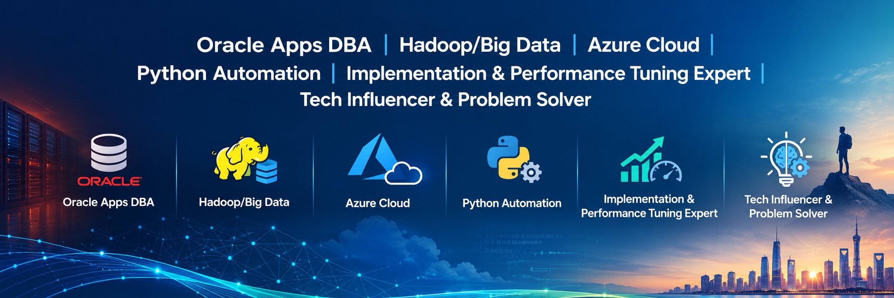

::: {.hero}

{.profile-image}

# Hi, I'm Danish. {#greeting}

I'm a technology enthusiast passionate about exploring emerging technologies and transforming ideas into practical, real-world solutions.

My interests include **Artificial Intelligence, Local LLMs, Computer Vision, Oracle Database, Cloud Technologies, Kubernetes, OpenShift, Automation, and Software Engineering.**

Here, I share technical knowledge, hands-on projects, practical notes, and lessons learned from continuous experimentation and professional experience.

**Keep learning. Keep building. Turn ideas into reality.**

[Explore my notes](notes/11g_Unknown_facts.qmd){.button}
[View projects](#projects){.button-secondary}

:::

## Now {#now}

I'm continuously exploring emerging technologies and expanding my technical knowledge in:

- **Artificial Intelligence:** Generative AI, Local LLMs, and intelligent applications.
- **Cloud Technologies:** Microsoft Azure, Google Cloud Platform, and cloud-native solutions.
- **Containers and Orchestration:** Kubernetes, Red Hat OpenShift, and container technologies.
- **Database Technologies:** Oracle Database, cloud databases, and database automation.
- **Software Engineering:** Python, Shell scripting, automation, and application development.

My focus is on transforming what I learn into practical solutions, improving existing processes, and sharing useful technical insights.

## Featured Notes {#featured-notes}

A collection of technical notes, experiments, and learning resources.

::: {.featured-grid}

::: {.note-card}

### [Local LLMs](notes/wip.qmd){.card-link}

Exploring locally hosted Large Language Models to build private, secure, and intelligent AI applications while maintaining control over sensitive data and infrastructure.

`Ollama` `OpenWebUI` `LLMs`

:::

::: {.note-card}

### [Red Hat OpenShift](notes/wip.qmd){.card-link}

Developing hands-on expertise in Kubernetes-based container orchestration, enterprise application deployment, hybrid cloud infrastructure, and cloud-native technologies.

`OpenShift` `Kubernetes` `Containers`

:::

::: {.note-card}

### [Artificial Intelligence](notes/wip.qmd){.card-link}

Exploring how AI can transform ideas into practical applications through intelligent solutions, workflow automation, and emerging generative AI technologies.

`ChatGPT` `Perplexity` `GenAI`

:::

:::

[Explore all notes →](notes/11g_Unknown_facts.qmd){.button .text-link}


## Achievements {#achievements}

Selected technical achievements, automation initiatives, and application development projects.

::: {.shelf-grid}

::: {.shelf}

### [Oracle Database Recovery & Cloning Automation](Achievements/wip.qmd)

Designed and implemented a menu-driven Oracle Database recovery and cloning framework, replacing manual operational procedures with a standardized and automated solution.

The framework improved operational efficiency, reliability, scalability, and database recovery turnaround time.

:::

::: {.shelf}

### [Oracle DB Creation – Enhancements & Bug Fixes](Achievements/wip.qmd)

Enhanced an existing Oracle Database creation framework to support newer database versions and enable parallel database provisioning across multiple target nodes.

Improved automation capabilities, operational efficiency, and deployment flexibility.

:::

::: {.shelf}

### [Banking Application Logic Optimization](Achievements/wip.qmd)

Identified and resolved a logic issue in the Finacle banking application involving the interpretation of user inputs and option selections.

Improved application reliability and ensured accurate processing of user-selected options.

:::

::: {.shelf}

### [Video Optimization – VEncoder](Achievements/wip.qmd)

Developed VEncoder, a macOS application designed to reduce video file sizes without compromising resolution.

Supports multiple encoding formats and parallel processing to leverage hardware acceleration, improve encoding performance, and optimize storage efficiency.

:::

:::

## Projects {#projects}

A selection of professional experience, technical implementations, automation solutions, and personal projects.

::: {.project-list}

::: {.project}

### [Oracle Database & EBS Administration](wip.qmd)

Experienced in Oracle Database and Oracle E-Business Suite administration, including database and EBS upgrades, installation, configuration, and deployment.

Worked with different database architectures, including:

- Oracle RAC and non-RAC environments.
- Multitenant architecture (CDB/PDB).
- Database upgrades and migrations.
- Oracle EBS 12.1.x and 12.2.x administration.
- Linux and Solaris environments.

Focused on maintaining supported versions, application compatibility, availability, security, and performance.

**Technologies:** `Oracle Database 10g–19c` `Oracle EBS 12.1.x–12.2.x` `Linux` `Solaris`<br>
**Clients:**
<a href="https://www.ca-cib.com/" target="_blank" rel="noopener noreferrer">CACIB</a> ·
<a href="https://www.mountsinai.org/" target="_blank" rel="noopener noreferrer">Mount Sinai</a> ·
<a href="https://www.ecgc.in/" target="_blank" rel="noopener noreferrer">ECGC</a> ·
<a href="https://www.netapp.com/" target="_blank" rel="noopener noreferrer">NetApp</a> ·
<a href="https://www.hdfc.bank.in/" target="_blank" rel="noopener noreferrer">HDFC Bank</a> ·
<a href="https://www.bell.ca/" target="_blank" rel="noopener noreferrer">Bell</a> ·
<a href="https://www.telefonica.com/en/" target="_blank" rel="noopener noreferrer">Telefónica</a> ·
<a href="https://www.bajajfinserv.in/" target="_blank" rel="noopener noreferrer">Bajaj Finserv</a> ·
<a href="https://www.zakathouse.org.kw/indexe.aspx" target="_blank" rel="noopener noreferrer">Zakathouse</a> ·
<a href="https://duniyafinance.com/" target="_blank" rel="noopener noreferrer">Duniya Finance</a>

:::

::: {.project}

### [Hadoop & Big Data Technologies](wip.qmd)

Worked with enterprise Big Data platforms and distributed data-processing technologies, including Hadoop ecosystems and streaming platforms.

Experience includes platform configuration, cluster administration, and supporting enterprise Big Data environments.

**Technologies:** `Hortonworks` `Cloudera` `Kafka` `Hadoop`<br>
**Clients:**
<a href="https://www.rogers.com/" target="_blank" rel="noopener noreferrer">Rogers Communications</a> ·
<a href="https://www.bmo.com/en-ca/main/personal/" target="_blank" rel="noopener noreferrer">BMO</a> ·
<a href="https://www.gapinc.com/en-us/" target="_blank" rel="noopener noreferrer">GAP</a> ·
<a href="https://www.marriott.com/default.mi" target="_blank" rel="noopener noreferrer">Marriott</a> ·
<a href="https://www.sncf-connect.com/en-en" target="_blank" rel="noopener noreferrer">SNCF</a> ·
<a href="https://www.mastercard.com/global/en.html" target="_blank" rel="noopener noreferrer">Mastercard</a>

:::

::: {.project}

### [Cloud Technologies – Azure & GCP](wip.qmd)

Exploring and working with cloud infrastructure and services across Microsoft Azure and Google Cloud Platform.

Focus areas include cloud infrastructure, resource provisioning, deployment architectures, and integrating enterprise technologies with cloud platforms.

**Technologies:** `Microsoft Azure` `Google Cloud Platform`<br>
**Clients:**
<a href="https://www.rogers.com/" target="_blank" rel="noopener noreferrer">Rogers Communications</a> ·
<a href="https://www.enbridge.com/" target="_blank" rel="noopener noreferrer">Enbridge</a>

:::

::: {.project}

### [Automation & Scripting](wip.qmd)

Developed automation solutions to simplify repetitive operational activities, reduce manual intervention, and improve productivity.

Focused on automating daily administrative tasks, routine jobs, and operational workflows.

**Technologies:** `Python` `Shell` `PowerShell`<br>
**Clients:**
<a href="https://www.ca-cib.com/" target="_blank" rel="noopener noreferrer">CACIB</a> ·
<a href="https://www.mastercard.com/global/en.html" target="_blank" rel="noopener noreferrer">Mastercard</a> ·
<a href="https://www.zakathouse.org.kw/indexe.aspx" target="_blank" rel="noopener noreferrer">Zakathouse</a> ·
<a href="https://www.knitwellgroup.com/" target="_blank" rel="noopener noreferrer">Ascena</a>

:::

:::

[Explore all projects on GitHub →](https://github.com/Danish297){.text-link}


## Elsewhere {#elsewhere}

```{=html}
<div class="social-inline" role="group" aria-label="Social media profiles">

  <span class="social-text">Connect with me on these platforms:</span>

  <a class="social-icon"
     href="https://linkedin.com/in/hasnain-danish-shaikh"
     target="_blank" rel="noopener noreferrer"
     aria-label="LinkedIn profile">
    
  </a>

  <a class="social-icon"
     href="https://github.com/Danish297"
     target="_blank" rel="noopener noreferrer"
     aria-label="GitHub profile">
    
  </a>

  <a class="social-icon"
     href="https://facebook.com/danish297"
     target="_blank" rel="noopener noreferrer"
     aria-label="Facebook profile">
    
  </a>

  <a class="social-icon"
     href="https://x.com/danish297/"
     target="_blank" rel="noopener noreferrer"
     aria-label="X profile">
    
  </a>

  <a class="social-icon"
     href="https://instagram.com/danishfrnz/"
     target="_blank" rel="noopener noreferrer"
     aria-label="Instagram profile">
    
  </a>

</div>
```

